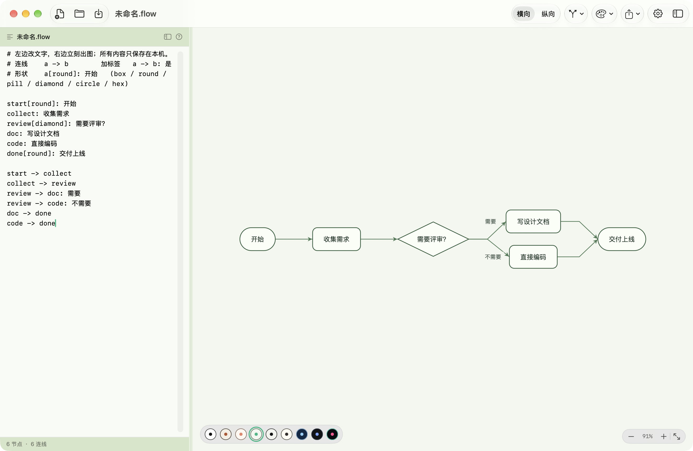
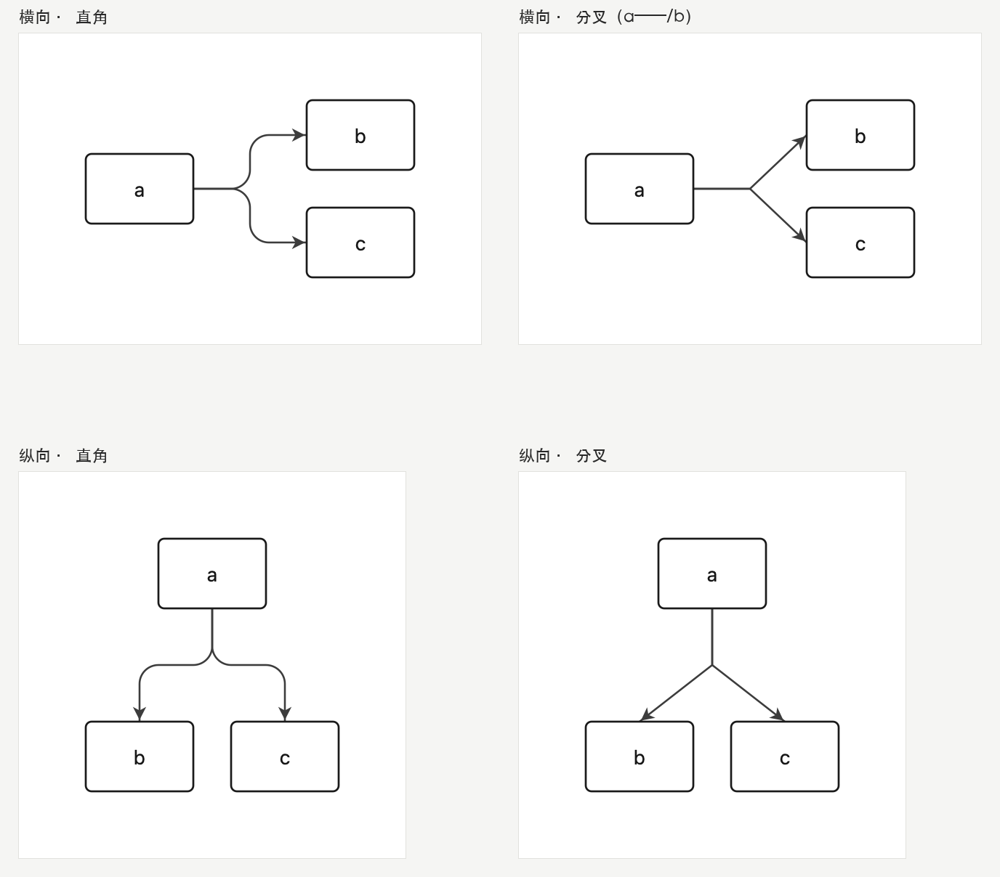
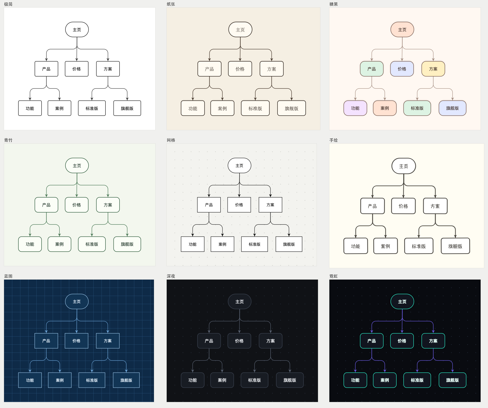
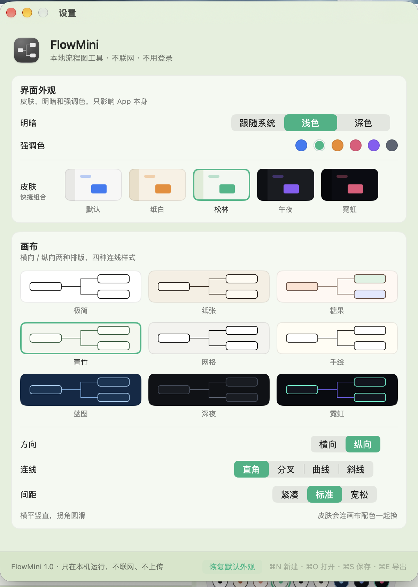

# FlowMini · 本地流程图

一个原生 macOS 小工具：左边写几行文字，右边立刻出现流程图。

- **不用登录、不联网、不上传**：没有任何网络代码，文件只存在本机
- **体积小**：`FlowMini.app` 约 2.3 MB（系统自带 SwiftUI，不打包运行时）
- **样式多**：9 套画布主题 × 4 种连线 × 横向/纵向 × 3 档间距，另有 5 套界面皮肤
- **能带走**：导出 PNG（2x）、PDF、SVG



## 安装

1. 解压 `FlowMini-1.0.zip`（或直接用本目录的 `dist/FlowMini.app`）
2. 把 `FlowMini.app` 拖进「应用程序」
3. 双击打开

> 应用是本地临时签名的。如果系统提示「无法验证开发者」，在 Finder 里右键 → 打开 → 再点「打开」即可；不需要关闭 Gatekeeper。
> 系统要求：macOS 14 或更新（Apple Silicon）。

## 写法

```
# 注释
a -> b            连线
a -> b: 是        连线文字
a --> b           虚线
a -- b            没有箭头的线
a: 显示文字        节点的文字
a[diamond]: 判断？  换形状
a -> b; a -> c    一行写多条
```

形状：`box`（默认）、`round`、`pill`、`diamond`、`circle`、`hex`、`data`、`docs`。

```
start[round]: 开始
collect: 收集需求
review[diamond]: 需要评审？
doc: 写设计文档
code: 直接编码
done[round]: 交付上线

start -> collect
collect -> review
review -> doc: 需要
review -> code: 不需要
doc -> done
code -> done
```

## 布局与连线



- **方向**：横向（从左往右）/ 纵向（从上往下），工具栏和设置里都能切
- **连线**：直角 / **分叉（先横后斜，就是 `a——/b` 那种）** / 曲线 / 斜线
- **间距**：紧凑 / 标准 / 宽松

## 主题



9 套画布主题：极简、纸张、糖果、青竹、网格、手绘、蓝图、深夜、霓虹。
画布左下角的小圆点可以一键切换。

## 界面皮肤



设置（⌘ ,）里是卡片式配置：

- 明暗：跟随系统 / 浅色 / 深色
- 强调色：6 种
- 皮肤：默认、纸白、松林、午夜、霓虹 —— 会连同**窗口配色和画布主题**一起换掉

## 导出与保存

- `⌘S` 保存 `.flow` 文件（纯文本，可以用任何编辑器打开）
- `⌘E` 导出 PNG（2 倍图）；菜单里还有 PDF（矢量）和 SVG（矢量）
- 没保存的草稿会自动留在本机，下次打开还在

## 快捷键

| 快捷键 | 功能 |
| --- | --- |
| ⌘N | 新建 |
| ⌘O | 打开 |
| ⌘S | 保存 |
| ⇧⌘S | 另存为 |
| ⌘E | 导出 PNG |
| ⌘0 | 适应窗口 |
| ⌘+ / ⌘− | 放大 / 缩小 |
| ⌥⌘E | 显示 / 隐藏文字面板 |
| ⌘ , | 设置 |

画布上：拖动平移，滚轮滚动，触控板捏合缩放，双击恢复适应窗口。

## 数据在哪

- 文档：你自己保存的 `.flow` 文本文件
- 当前草稿和界面设置：`defaults` 里的 `com.flowmini.app` 域（本机 UserDefaults）
- 不写入任何服务器，也没有账号体系

## 从源码构建

```bash
./build.sh          # 编译 → 生成图标 → 签名 → dist/FlowMini.app + zip
```

只用系统自带的 Swift 工具链（Command Line Tools），不需要 Xcode 工程。

源码结构：

```
Sources/
  Model.swift       文本语法解析
  Layout.swift      分层布局（含虚拟节点、回边、重心法排序）
  Theme.swift       9 套画布主题与尺寸
  Renderer.swift    CoreGraphics 绘制
  Exporter.swift    PNG / PDF / SVG
  Appearance.swift  界面皮肤
  Store.swift       状态、文件、导出
  ContentView.swift 主界面
  SettingsView.swift 设置窗口
  DiagramView.swift  画布（缩放、平移）
  App.swift / CLI.swift / main.swift
```

命令行也能批量出图：

```bash
FlowMini.app/Contents/MacOS/FlowMini --render 图.flow --out 图.png --theme paper --direction TB --style fork --scale 2
FlowMini.app/Contents/MacOS/FlowMini --render 图.flow --out 图.svg --format svg
```
