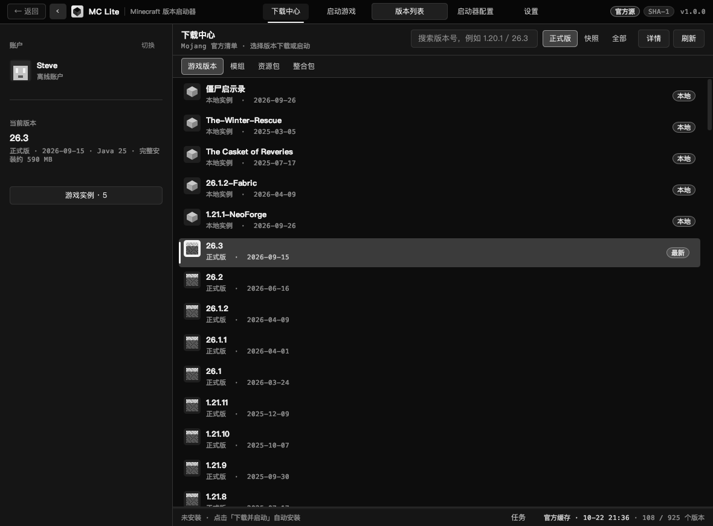
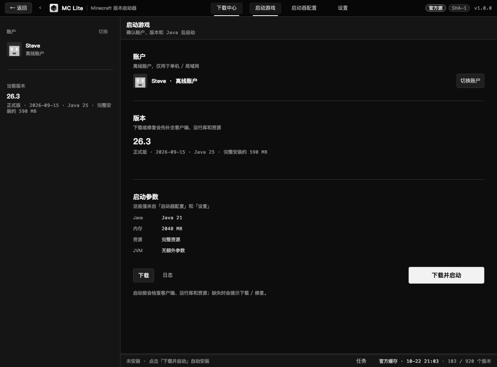

# MC Lite

Java 21 + Swing 写的 Minecraft 启动器，支持 Windows、macOS 和 Linux。





## 能做什么

- 从 Mojang 获取完整版本列表，正式版、快照和旧版本都能选。
- 读取本地客户端、运行库和资源文件；游戏本体需自行从官方渠道获取。
- 每个版本可以单独隔离存档、模组、资源包和配置。
- 扫描本地 `versions/`，也支持导入 HMCL 的游戏目录。
- 离线账户的创建、切换、删除，以及皮肤头像。
- 自动检测 Java；缺少运行时会自动从 Mojang 下载，也可以手动添加 `java` / `java.exe`。
- Java 管理列表新增「下载 Java…」，可选 Java 8/17/21 和 arm64/x86_64 架构。
- Apple Silicon 上 Java 8 自动使用 x86_64 + Rosetta；整合包声明 x86-only native 时自动选 x86。
- 调整内存、JVM 参数、窗口大小和界面 CSS。
- 下载模组、资源包和光影，支持 Modrinth、CurseForge 和 MC百科中文搜索。
- 版本详情会显示必需前置、内置模组和可选前置，点击模组名称可直接打开该模组的下载页；
  安装时自动补齐必需前置。
- 内容图标会先走 PNG 转换和本地磁盘缓存，避免 WebP 图标每次重新解码导致下载页加载很慢。
- 下载页底部操作栏改为不透明、置顶并修正淡入裁剪；列表底部增加渐变遮罩，避免最后一个模组只露出半截图标。
- 整合包下载页和「版本列表」都支持导入本地 Modrinth `.mrpack` 或 CurseForge 整合包 ZIP；
  「版本列表」右上角是「ZIP 安装」。选择文件/文件夹使用系统原生窗口。
- 整合包会安装到当前游戏目录的 `versions/<包名>`，不会再新建 `instances/<包名>`，
  也不会把当前游戏目录切换成新实例。
- 修复 CurseForge 整合包把 `fabric-loader-0.20.1` 误解析成 `loader-0.20.1`
  导致的 `HTTP 400: fabric 加载器配置`。
- 单个文件下载超时从最少 3 秒放宽到 20 秒，减少慢连接被误判为失败（日志里的 `closed`）。
- 下载任务、进度、速度、剩余时间，以及异常退出后的崩溃报告。

## 运行

当前版本：V1.1.59

需要 Java 21 或更高版本。

```bash
./run-region.sh
```

macOS 可以打开 `dist/MC Lite Region v1.1.59.app`，或者双击 `启动器-地区版.command`。

Windows：

```bat
run-region.bat
```

也可以直接运行：

```bash
java -jar dist/MCLite_v1.1.59-region.jar
```

## 地区限制

启动时会向 Cloudflare 查询网络归属地，只读取 `loc` 字段，不保存 IP。网络不可用时，退回到系统语言和时区。

出口 IP 在中国大陆时：

- 不下载游戏本体
- 没有本地游戏版本时，不下载加载器
- 不下载整合包
- 模组、资源包和光影仍然可以下载
- 游戏本体和整合包会跳转到官网，由用户自行下载

内置锁定，正常使用无法通过 `--region` 参数关闭。锁定文件随 jar 分发。

为遵守相关法律法规，我们不对中国大陆地区提供游戏本体和整合包下载服务，模组下载服务可用，请前往官网自行下载。

## 版本命名

- 小版本：`x.y.(z+1)`
- 大版本：`x.(y+1).(z+5)`

构建文件、应用包和启动器内部版本都使用同一个版本号。

升级版本：

```bash
./bump-version.sh patch
./bump-version.sh major
```

然后重新运行 `./build.sh`。

## 构建

```bash
./build.sh
```

会生成：

```text
dist/MCLite_v1.1.59.jar
dist/MCLite_v1.1.59-region.jar
dist/MCLiteBenchmark.jar
dist/MC Lite v1.1.59.app
dist/MC Lite Region v1.1.59.app
dist/MC-Lite_v1.1.59_macOS.zip
dist/MC-Lite_v1.1.59_region_macOS.zip
dist/MC-Lite_v1.1.59_region_Windows.zip
dist/SHA256SUMS.txt
```

Windows 解压 `dist/MC-Lite_v1.1.59_region_Windows.zip`，双击 `start.bat`。

## 测试

```bash
./test.sh          # 构建并运行普通版、地区版自检
./test-update.sh   # 模拟一次真实更新，检查 jar / macOS 应用包是否被原地替换
```

## 自动更新

启动器会后台检查 GitHub 最新 Release，不影响正在运行的游戏。

- 地区版下载地区版 jar
- 普通版下载地区版 jar，并在本地移除地区限制后使用
- 更新会直接替换你正在使用的 jar 或 macOS 应用包，不再长期从 `~/.mclite/updates/` 启动
- 下载完成后，下次启动启动器时应用；应用后会清理旧版本和缓存
- 更新弹窗和下载完成提示会显示本次 GitHub Release 的更新内容；说明从网络读取，
  不会打包进启动器 jar 或游戏包
- 启动器更新会同时从 GitHub 直连和多个加速镜像竞速，取最先完成的源；全部失败才回退单源下载
- Windows 安装版会同时更新安装目录里的 jar 和桌面/开始菜单快捷方式
- macOS 会更新 `.app` 内的 jar、启动脚本和 `Info.plist`，并把应用包改成新版本名
- 从 1.1.34 及更早版本首次升级时，会通过父进程命令行找到旧 jar / `.app`，把新版本补装回原位置，解决旧版只会从 `~/.mclite/updates/` 启动的问题
- 普通版可以在设置中关闭自动更新，也可以关闭“更新时移除地区限制”

GitHub Release 只需要上传地区版资源：

```text
MCLite_v版本-region.jar
```

只有 tag、没有 jar 附件的 Release 不会触发更新。

普通版更新使用地区版 jar 的副本，并在本地移除地区限制；普通版源码和普通版 jar 不发布。

更新包会校验 GitHub Release 提供的 SHA-256，并检查 `Main-Class`、`region.lock`、
`unrestricted` 标记和内部版本号，校验失败不会写入安装目录。

## 备份

每个版本构建后会把普通版文件复制到：

```text
神秘小文件/v版本/
```

包含 jar、安装包、macOS 应用和 zip。`v1.0.14` 之前的旧备份已清理。

## Windows 安装版

```text
dist/MC-Lite_v1.1.59_Setup.exe
```

安装到当前用户的 `%LOCALAPPDATA%\Programs\MCLite`，不需要管理员权限。

会创建桌面和开始菜单快捷方式，并写入卸载项。安装包是 NSIS 安装器，不是临时目录自解压，也不经过 bat 脚本。

## Java 和游戏目录

默认目录是 `~/.mclite`。游戏目录可以在启动器配置里修改，也可以直接导入 HMCL 的目录。

Windows 安装版内置独立的 Java 21 运行时，使用自己的 `runtime`，不会修改或覆盖系统 JDK。

macOS 设置页有一项「强制使用 Metal 渲染」，只影响启动器界面，重启后生效；如果开启后黑屏，关闭它再重启。

紧急恢复时可以加参数启动：

```bash
java -jar dist/MCLite_v1.1.59.jar --software-render
```

启动器日志在 `~/.mclite/logs/`。设置页右上角有「打开日志目录」。Windows 下路径为：

```text
C:\Users\<用户名>\.mclite\logs
```

版本隔离默认开启。关闭后，所有版本共用同一个 `.minecraft`。

## 下载内容

- Modrinth 不需要 Key。
- CurseForge 要在设置里填写自己的 API Key。
- 搜索排序会跟随内容源切换：Modrinth 支持相关度/下载量/关注量/最新发布/最近更新，
  CurseForge 支持推荐/热门/最近更新/名称。
- 选中项目时会自动检查当前实例是否已安装，并显示已安装文件名；重复安装会二次确认。
- 模组、资源包、光影会安装到当前实例对应的目录。
- 下载的模组版本会跟随当前选择的游戏版本，整合包版本也会自动识别。
- 安装加载器后勾选推荐模组，会在加载器和游戏本体装完后单独开始推荐模组下载链，
  最多同时下载 4 个模组，进度显示为 `Fabric / Sodium / 1.21` 这种
  “加载器 / 模组 / 游戏版本”格式；模组直接下载到本体实例的 `mods` 文件夹，
  保持原始文件名，不会改名。
- 推荐优化模组默认包含 Sodium、Lithium、ImmediatelyFast、Entity Culling、More Culling、
  BadOptimizations、FerriteCore、Krypton、Sodium Extra；8 区块下的目标为 300+ 帧，
  实际帧率取决于 CPU/GPU。C2ME 作为实验性选项默认不勾选。
- 实用类推荐包括 Fabric API、Jade、EMI；Xaero's Minimap/World Map、AppleSkin、
  Controlling 等按需勾选。

## 实例管理

在「版本列表」里选中实例后，可以重命名或删除实例。

- 「重命名」会同时修改版本文件夹、版本 JSON、加载器备份和内部 ID，mods/saves 一起保留。
- 可以连续点击下载多个版本，任务会进入下载队列，当前任务结束后自动开始下一个。
- 「更新模组」会把当前实例的推荐优化模组更新到最新兼容版本，并删除同项目的旧模组文件。
- 「删除实例」永久删除该实例。

- 开启版本隔离时，会删除 `versions/<实例名>/` 下的版本文件、`mods`、`saves`、`config`。
- 关闭版本隔离时只删除版本文件，共享的 `mods` / `saves` 不会动。
- 删除前会二次确认；游戏正在运行或安装任务进行中时不允许删除。
- 启动前会检查 `mods`：没有加载器、jar 损坏或缺少对应加载器元数据时会提示，避免模组没被加载。

## 模组加载器

安装 Fabric、Quilt、Forge 或 NeoForge 时，加载器会合并进对应的游戏本体版本文件夹
（例如 `versions/1.21`），不再额外生成一个加载器版本/实例文件夹。

- 原版版本 JSON 会备份为 `1.21.vanilla.json`，再次安装或切换加载器时以它为基础合并。
- 旧版加载器实例里的 `mods`、`saves`、`config` 等会迁移到本体文件夹。
- 迁移完成后会删除空的旧加载器文件夹；如果文件冲突则保留并在日志里提示。
- 已经有两个文件夹的用户，重新安装一次加载器即可合并。
- 启动前会重新读取本地合并后的版本 JSON，避免使用旧缓存的原版 mainClass 启动。

## 下载速度

- 官方源和 BMCLAPI 镜像会先做 128KB 吞吐探测，只从更快的源下载，不再同时下载完整的两份。
- 默认使用 8 个文件线程和 24 个资源线程；高带宽网络可以用
  `-Dmclite.download.fileThreads=16 -Dmclite.download.assetThreads=48` 调整。
- 8MB 以上的大文件默认使用 4 路分段下载；如果服务器不支持 Range 会自动改用单连接，
  也可以用 `-Dmclite.download.segments=1` 关闭；Modrinth 模组默认不分段。
- 多线程进度采样已串行化，速度显示不会因为并发写入而越来越小。
- 下载失败会自动重试并切换备用源；临时 `.part` 文件会清理。
- Modrinth 文件会优先解析到较快的 Fastly 151.101 节点，并用 3 路并行模组下载提速。
- 点击「取消当前任务」会立即把任务标记为已取消并停止进度刷新，不再继续显示下载中。

## 安全

- 只从 HTTPS 白名单域名下载。
- Mojang 和 Modrinth 文件会校验哈希。
- 启动器更新会校验 GitHub Release 提供的 SHA-256（可用时）和 jar 结构。
- 下载先写临时文件，校验通过后再替换。
- 解压和路径检查限制在目标目录内。
- 不保存密码和 access token。
- 不安装系统服务；自动更新只替换启动器自身文件，不修改系统组件。

更详细的白名单和校验说明见 [SECURITY.md](SECURITY.md)。

## 账户和皮肤

离线账户默认保存在 `~/.mclite/accounts/`，可以在设置里改位置。

离线模式不会自动加载皮肤。需要皮肤的话，游戏内要装 CustomSkinLoader 一类的模组。

## 使用要求

- 使用本启动器需要自备正版 Minecraft。
- 游戏本体和整合包需要自行从官方渠道获取，再导入本地实例。
- 本项目与 Mojang、Microsoft、网易均无关联。
- Minecraft 是 Mojang Studios / Microsoft 的商标。
- Fabric、Forge、NeoForge、Quilt 是各自项目的商标。
- MC百科简介来自公开搜索结果，遵循 CC BY-NC-SA 3.0，并保留原文链接。
- 账户信息只存在本地，以明文保存，不保存密码或 access token。
- 本项目使用 PolyForm Noncommercial 1.0.0，不得主要用于商业利益或获取金钱报酬。许可证在 `META-INF/LICENSE`。
- 修改版必须保留 NOTICE，并标注为非官方修改版。
